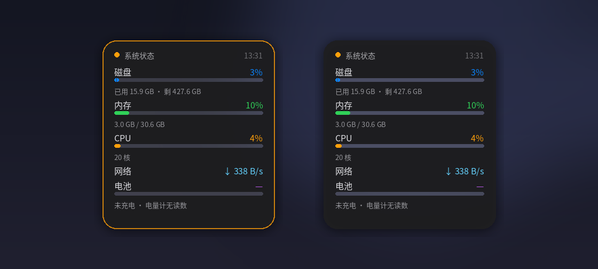

# sysmon-card · 桌面系统状态卡片

一张贴在桌面上的 macOS 风格状态卡片：**磁盘、内存、CPU、网络、电池**，实时刷新。
它只活在桌面层 —— 打开任何应用窗口都会把它盖住，回到桌面又在那儿，像桌面图标一样。



## 特性

- **桌面层显示**：不是悬浮窗，不会挡在任何窗口上面
- **可拖动**：按住拖动，松手记住位置（下次启动还原）
- **双击固定**：双击锁定位置，再双击解锁；未固定时卡片带一圈黄色描边
- **零后台服务**：一个脚本，读系统接口，不联网、不上报、不写日志
- **深色毛玻璃风格**：圆角、柔和阴影、彩色进度条

## 平台支持

| 平台 | 状态 | 说明 |
| --- | --- | --- |
| Linux (GNOME/Wayland) | ✅ 实测可用 | XWayland 下声明为桌面窗口类型 |
| macOS | ⚠️ 未实测 | PyObjC 桌面层级实现，逻辑参照 Apple 文档编写 |
| Windows 10/11 | ⚠️ 未实测 | 挂到 Explorer 的 WorkerW 桌面层，参照 Rainmeter 方案编写 |

> 诚实说明：作者只在 Linux 上跑通过。macOS / Windows 两份是按各自平台的桌面层机制写的，
> 没有真机验证。欢迎提 issue 或 PR 帮助修正。

## Linux

依赖：`python3-gi`（GTK3）、`python3-pil`（Pillow）、XWayland（GNOME Wayland 会话默认带）。

```bash
sudo apt install python3-gi python3-pil
cd linux
GDK_BACKEND=x11 python3 sysmon-card.py
```

开机自启：

```bash
bash install/linux-autostart.sh
```

> 必须用 `GDK_BACKEND=x11` 启动：GNOME Wayland 会话下只有 XWayland 才能声明「桌面窗口类型」。

## macOS

依赖：

```bash
pip3 install pillow pyobjc-framework-Cocoa psutil
python3 macos/sysmon_card.py
```

开机自启（写入 LaunchAgent）：

```bash
bash install/macos-autostart.command
```

## Windows 10/11

依赖：

```bash
pip install pillow
```

双击 `windows/sysmon_card.pyw` 运行（`.pyw` 不弹命令行窗口）。

开机自启：

```powershell
powershell -ExecutionPolicy Bypass -File install\windows-autostart.ps1
```

## 使用

| 操作 | 效果 |
| --- | --- |
| 按住卡片拖动 | 移动位置，松手自动保存 |
| 双击卡片 | 固定 / 解锁位置 |
| 黄色描边 | 表示当前未固定，可以拖动 |
| 无描边 | 已固定，拖不动 |

## 配置与状态

位置和固定状态只存在本地一个 JSON 文件里：

- Linux：`~/.config/sysmon-card.json`
- macOS：`~/Library/Application Support/sysmon-card.json`
- Windows：`%APPDATA%\sysmon-card.json`

删掉它就回到默认位置（屏幕右上角）。

## 数据来源

全部读本地系统接口，不联网：

- 磁盘：`statvfs` / `shutil.disk_usage`
- 内存：`/proc/meminfo`（Linux）、`GlobalMemoryStatusEx`（Windows）、`psutil`（macOS）
- CPU：`/proc/stat`（Linux）、`GetSystemTimes`（Windows）、`psutil`（macOS）
- 网络：`/proc/net/dev`（Linux）、性能计数器（Windows）、`psutil`（macOS）
- 电池：`/sys/class/power_supply`（Linux）、`GetSystemPowerStatus`（Windows）、`psutil`（macOS）

## 已知限制

- Linux 版依赖 XWayland；纯 Wayland 下无法声明桌面窗口层级
- 电池栏在电量计不报数的机器上会显示「—」，这是硬件/驱动限制，不是程序 bug
- Windows 的 WorkerW 方案在部分系统版本上会被 Explorer 重建吞掉，脚本里有降级处理（压到所有窗口底部）
- 高 DPI 下卡片位图会被放大绘制，边缘略柔

## License

MIT
